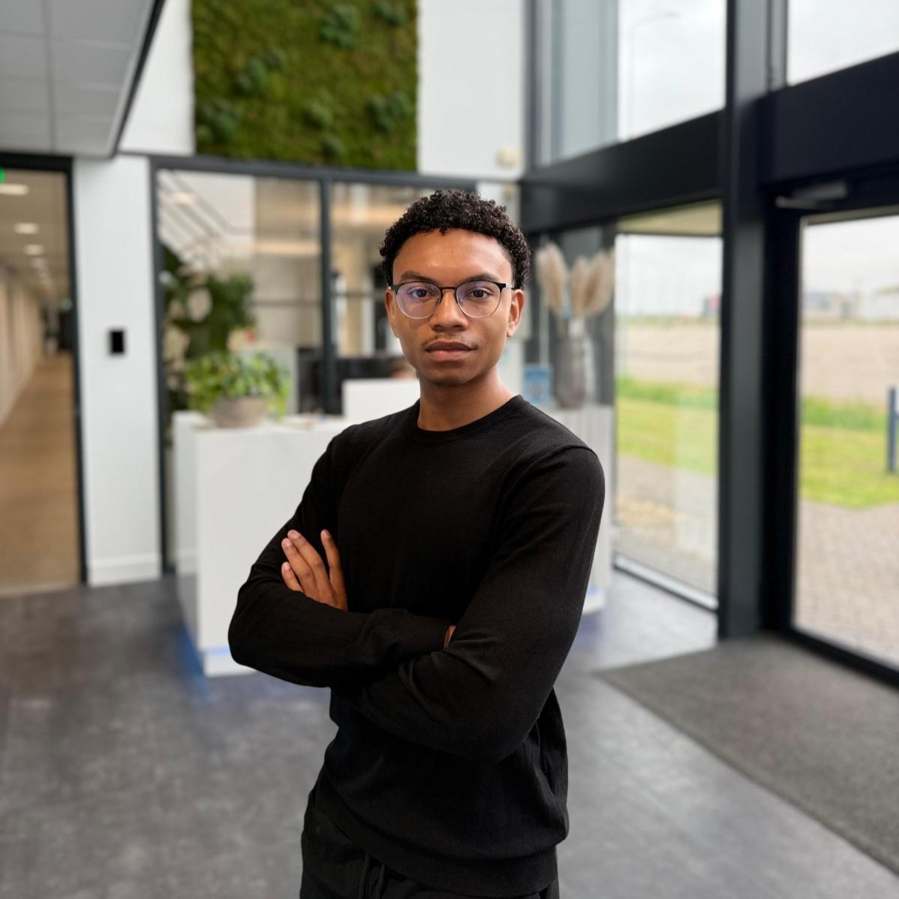

# Turn AI complexity into your competitive advantage

### I have 2+ years experience doing just that

- Are you struggling to keep up with the rapid pace of AI innovation?

- Do you need help translating AI hype into real business results?

- Want to implement AI effectively before competitors get ahead?

- Looking for technical expertise and a clear roadmap for AI solutions?

- Need someone who understands both technical and business perspectives?

[Book Free Intro Call :material-arrow-top-right:](https://calendly.com/tdoesburg-devaware/30min){ .md-button .md-button--primary }

{ .profile-image alt="Portrait of Taylen Doesburg, AI engineer" }

## About me

Hi! I'm Taylen, an AI engineer from the Netherlands. I work with with SMEs and enterprises that feel the pressure of AI—but struggle to turn it into something practical, secure, and valuable.

The pace of AI innovation is overwhelming. New models, tools, and frameworks appear every month. Technical teams worry their skills are becoming outdated, while organizations hesitate—unsure where to start, what to trust, or how to avoid costly mistakes. Meanwhile, competitors are already moving.

That gap between AI potential and real-world application is where I work.

Over the past two years, I’ve focused on designing and building production-ready AI solutions that fit existing systems and workflows. My background is grounded in data science fundamentals, with hands-on experience using Python and C#, and a strong focus on the Microsoft Azure AI ecosystem. I’m Microsoft Azure AI Fundamentals certified and work daily with modern AI building blocks such as vector databases, retrieval-augmented generation (RAG), and large language model (LLM) integration.

## Why work with me?

Here’s what sets me apart and how I help organizations create real value with AI:

-   :fontawesome-solid-building-user:{ .lg .middle } Engineering-Driven, Business-Aware

    ---

    I work as an AI engineer and architect, bridging the gap between technical possibilities and business reality. My focus is on building AI solutions that integrate with existing systems and align with business goals—so AI becomes a practical capability, not a disconnected experiment.

-   :material-comment-account-outline:{ .lg .middle } Communication

    ---

    AI only creates value when people understand it. I translate complex AI concepts into clear, actionable explanations for both technical teams and decision-makers. You’ll always know why a solution is built a certain way, what it delivers, and how it fits into your organization.

-   :material-school:{ .lg .middle } Technical Foundation

    ---

    My background is grounded in the foundations of data science, with hands-on experience in Python and C#. I’m Microsoft Azure AI Fundamentals certified and work with modern architectures such as vector databases, RAG, and LLM integration for enterprise use cases.

-   :material-rocket:{ .lg .middle } Production-Focused Implementation

    ---

    I specialize in building production-ready AI solutions, not proofs of concept that never scale. By using proven tools and pragmatic architectures, I help organizations move efficiently from idea to working solution—without unnecessary complexity or technical debt.

## Frequently asked questions

??? note "How quickly can you start working on my project?"
    I can typically begin new projects within 1 week of contract signing. For urgent matters, I maintain some flexibility for rapid response situations and can potentially start sooner - just let me know your timeline during our initial consultation.

??? note "Do you require a minimum project size or commitment?"
    While I prefer projects of at least 20 hours to for meaningful , right now I'm open for any size. We can of course start with a small pilot project to ensure we're a good fit.

??? note "What industries do you have experience in?"
    I've successfully delivered projects across e-commerce, construction, and heath &beauty. While I specialize in workflow automation that applies across sectors, I particularly excel in projects involving customer service and process optimization.

??? note "How do you handle data security and confidentiality?"
    I take data security extremely seriously. I sign comprehensive NDAs before starting any project, use enterprise-grade encryption for all data transfers, and follow industry best practices for data handling. I can also work within your existing security infrastructure and policies.

??? note "What's your pricing structure?"
    I offer both project-based and hourly-rate. Project fees are based on scope, complexity, and value delivered. Let's discuss your specific needs during a introduction call to determine the most cost-effective approach.

??? note "How do you communicate progress and results?"
    I maintain clear communication through weekly progress updates and regular check-in meetings.

-   :material-coffee:{ .lg .middle } Let's have a virtual coffee together!

    ---
    
    Want to see if we're a match? Let's have a chat and find out. Schedule a free 30-minute strategy session to discuss your AI challenges and explore how we can work together.

    [Book Free Intro Call :material-arrow-top-right:](https://calendly.com/tdoesburg-devaware/30min){ .md-button .md-button--primary }

